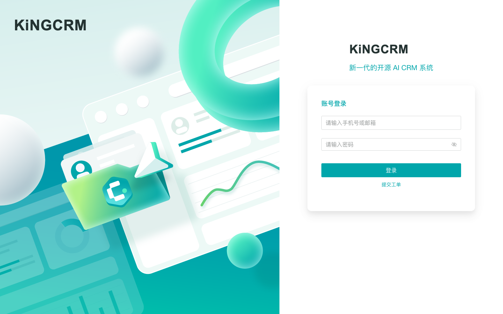
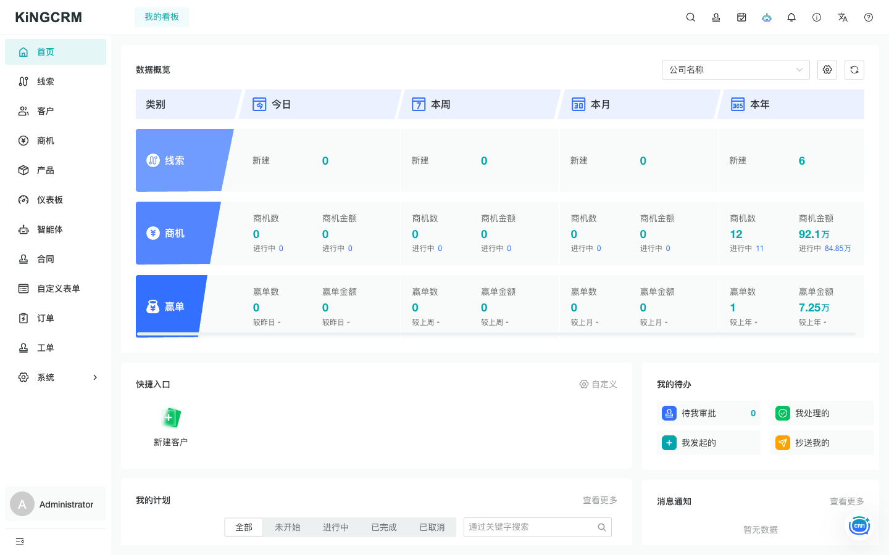
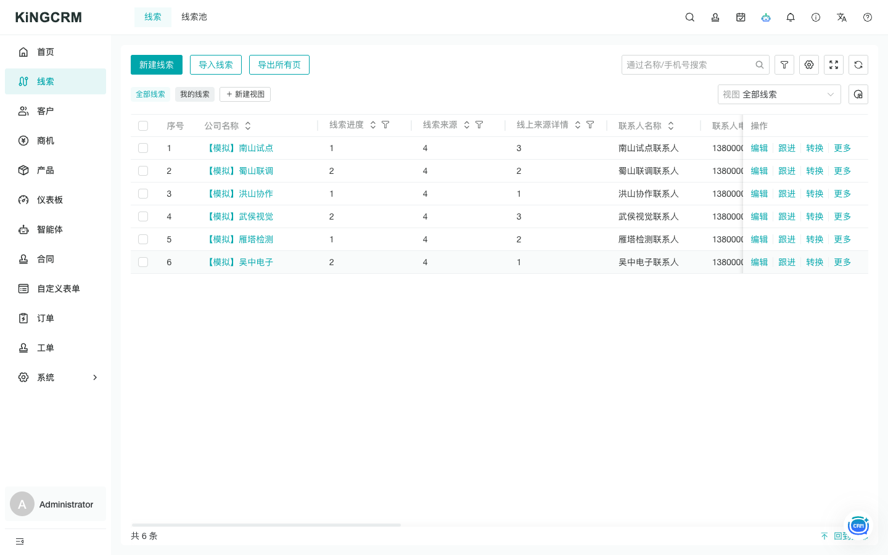
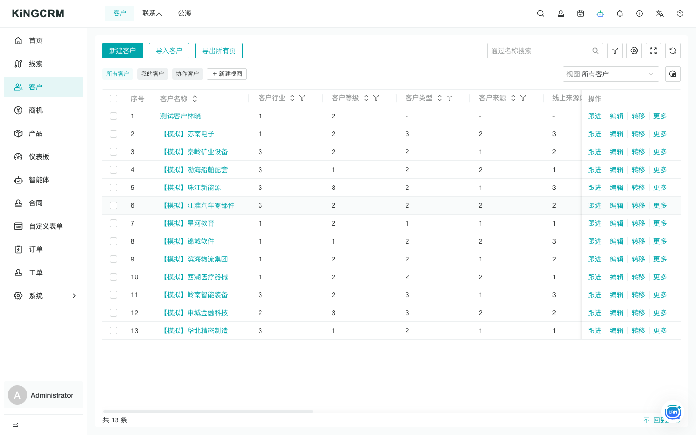
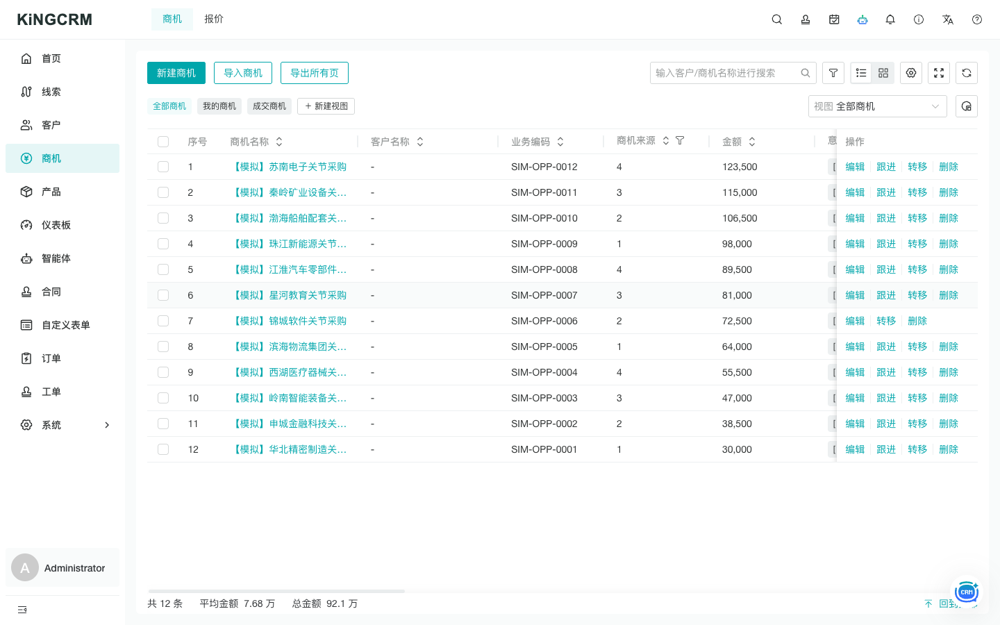
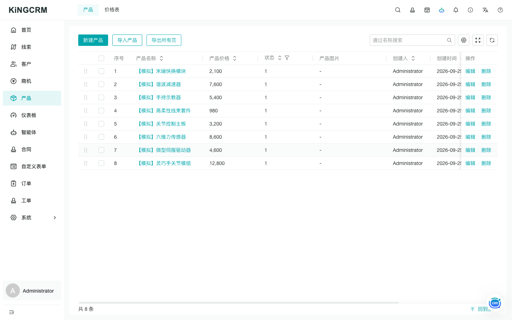
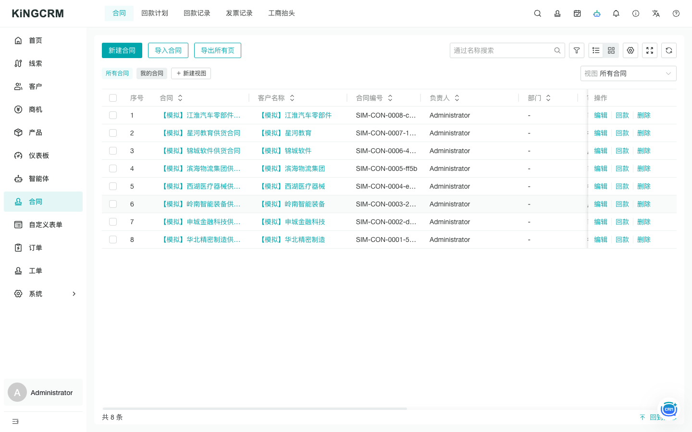
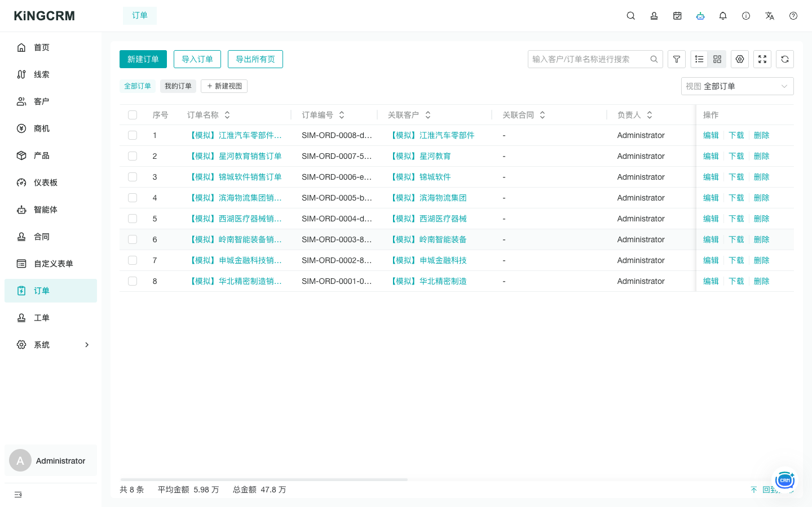
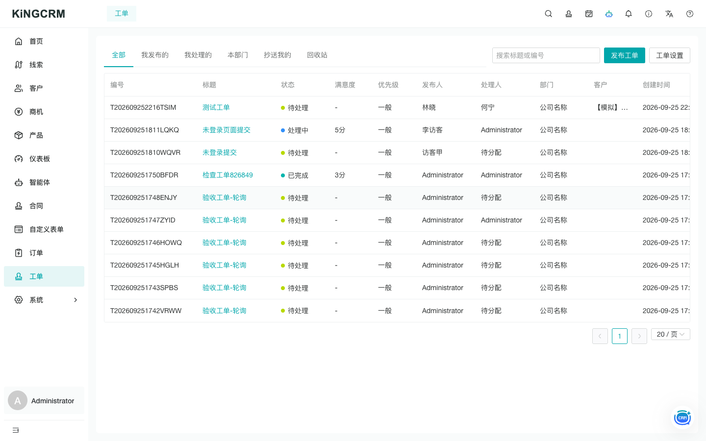
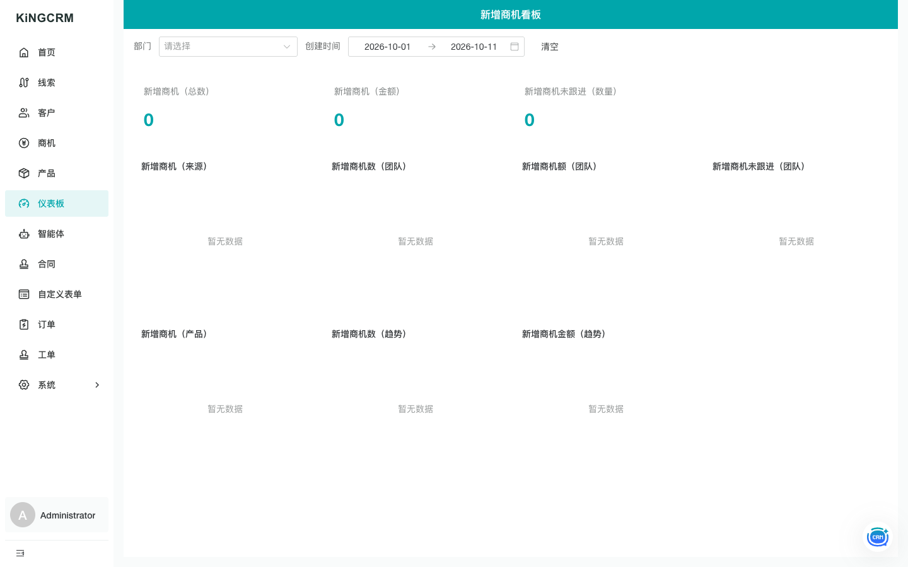

# KingCRM 项目介绍

KingCRM 是一套可以独立运行的 CRM。它包含 PC 前端、移动端前端和 Node.js 后端，直接使用现有 MySQL 库 `kingcrm`，不另建一套表结构。

销售从线索跟到客户、商机、报价、合同和订单。首页看当天和本月的数量与金额，工单用来接客户问题。组织、角色和模块开关决定谁能看到哪些菜单。

旁边的 Java 后端保留作对照。日常开发连的是本目录里的 Node 后端。下面的截图来自本机 PC 端，左上角标识是 KingCRM。

## 界面

### 登录



账号登录。同一页可以进入对外提交工单。

### 首页



工作台按今日、本周、本月、本年汇总线索、商机和赢单，下面是快捷入口、待办、跟进计划和消息。

### 线索



线索列表可以新建、导入、跟进，也可以转入客户。线索池是另一页。

### 客户



客户按全部、我的、协作来分。联系人和公海在同一模块的另外两个页签。

### 商机



商机记录金额和阶段，列表底部给出平均金额和总金额。报价在旁边的页签。

### 产品



产品维护名称和价格。价格表单独一页。

### 合同



合同关联客户，并带上回款计划、回款记录、发票和工商抬头。

### 订单



订单关联客户和合同，列表汇总平均金额和总金额。

### 工单



工单按全部、我发布的、我处理的、本部门、抄送和回收站查看，可以发布、分配和回复。

### 仪表板



仪表板按部门和时间统计新增商机的数量、金额和跟进情况。

## 1. 目录

```text
KingCRM/
  src/                         Node 后端
  frontend/
    packages/web/              PC 端（Vue 3）
    packages/mobile/           移动端（Vue 3）
    packages/lib-shared/       两端共用的接口、模型和工具
  .env                         后端本地配置，不提交
```

后端按路由、控制器、服务、模型分开：

| 层 | 目录 | 职责 |
| --- | --- | --- |
| 入口 | `src/index.ts`、`src/app.ts` | 启动 Fastify、挂认证、注册路由 |
| 路由 | `src/routes/index.ts` | 按模块注册控制器 |
| 控制器 | `src/http/controllers/` | 解析请求、校验参数、返回统一结果 |
| 服务 | `src/services/` | 业务规则 |
| 模型 | `src/models/` | SQL 与表读写 |
| 支撑 | `src/support/` | 数据库连接、会话、权限、分页、加密 |

业务对象清单在 `src/services/crm-catalog.ts`。客户、线索、商机、合同、订单、产品等列表，都按这份清单映射到表、权限和接口前缀。

## 2. 怎么运行

需要 Node.js 20 或更高版本，以及本机 MySQL。开发库在 Docker 容器 `kingcrm-mysql` 里，库名 `kingcrm`，端口 `3306`。账号和密码写在后端 `.env`，不要写进文档或提交到仓库。

后端 `.env` 主要项：

| 变量 | 本地值 |
| --- | --- |
| `PORT` | `8083` |
| `HOST` | `0.0.0.0` |
| `MYSQL_HOST` | `127.0.0.1` |
| `MYSQL_PORT` | `3306` |
| `MYSQL_DATABASE` | `kingcrm` |
| `SESSION_TTL_MS` | 30 天 |
| `CRM_VERSION` | `node-0.1.0` |

启动：

```bash
# 后端，目录 KingCRM
npm install
npm run dev

# PC 前端，目录 frontend/packages/web
pnpm install
pnpm dev
```

| 服务 | 地址 |
| --- | --- |
| PC 前端 | `http://127.0.0.1:5173` |
| Node 后端 | `http://127.0.0.1:8083` |
| 健康检查 | `GET /health` |

前端是 Hash 路由，登录页是 `http://127.0.0.1:5173/#/login`。

开发时代理前缀是 `/front`，会去掉这个前缀再转发到 `VITE_DEV_DOMAIN`。仓库里的 `.env.development` 指向 `8081`（Java）。本机要连 Node，使用被 git 忽略的 `.env.development.local`，把 `VITE_DEV_DOMAIN` 设为 `http://127.0.0.1:8083`。

本地登录账号是 `admin`，密码是 `admin`。密码在库里存的是 UTF-8 小写 MD5。`src/config/index.ts` 里的 `DEFAULT_ADMIN_PASSWORD` 是 `KingCRM`，只用来判断是不是还没改过默认密码，不要把它改成 `admin`。

后端重启后，内存里的登录会话会丢失，需要重新登录。

生产运行不要用 `tsx watch`。后端先 `npm run build`，再 `npm start`。前端用 `pnpm build` 的产物，由 Nginx 托管，并把 `/front` 反代到 Node。

## 3. 前端

PC 端是 Vue 3 + TypeScript + Vite + Pinia + Vue Router + Naive UI。移动端是独立包，共用 `lib-shared`。

页面按业务模块放在 `frontend/packages/web/src/views/`，路由在 `frontend/packages/web/src/router/routes/modules/`。

| 路由 | 页面 |
| --- | --- |
| `/#/login` | 登录 |
| `/#/workbench` | 工作台 |
| `/#/lead` | 线索、线索池 |
| `/#/account` | 客户、公海、联系人 |
| `/#/opportunity` | 商机、报价 |
| `/#/product` | 产品、价格 |
| `/#/contract` | 合同、回款、发票 |
| `/#/order` | 订单 |
| `/#/dashboard` | 仪表板 |
| `/#/agent` | 智能体 |
| `/#/system` | 组织、角色、模块、消息、审批、企业设置、日志 |

菜单是否出现，由组织的模块开关决定。开关存在 `sys_module`。当前默认组织 `100001` 已开启首页、线索、客户、商机、产品、仪表板、智能体、合同、订单等模块。

接口定义在 `frontend/packages/lib-shared/api/`。请求经过 axios，开发环境 URL 以 `/front` 开头。成功时拦截器只把响应里的 `data` 交给页面。

登录流程：

1. `GET /get-key` 拿到 RSA 公钥。
2. 浏览器用 JSEncrypt 做 PKCS#1 v1.5 加密后提交 `POST /login`。
3. 之后的写请求带 `x-auth-token`、`csrf-token` 和 `organization-id`。

产品名称是 KingCRM。侧栏、登录页和顶栏用的 logo 文件名是 `logo_kingcrm.svg`，收起侧栏时用 `KingCRM.svg`。

企业设置里有「模拟数据」。生成的线索、客户、商机、合同、订单、产品，名称都以 `【模拟】` 开头。同一页可以一键删除，只删除这批数据。

## 4. 后端

技术栈是 Fastify 5、TypeScript（ESM）、mysql2、zod。没有把 Java 的 Shiro、Redis、Flyway 再实现一遍。会话放在进程内存，连接池在 `src/support/db.ts`。

### 4.1 请求怎么走

`src/app.ts` 对每个请求先做认证。公开接口只有健康检查、取公钥、登录、登出、是否登录、界面预览，以及图片和附件的预览下载。单点登录回调也是公开的，当前直接返回未启用，不会建会话。

其余接口需要登录。非 GET 还要校验 CSRF。管理员用户 `admin` 跳过权限点检查，其他用户按当前组织的角色权限判断。权限点常量在 `src/support/permission.ts`。

控制器用 zod 校验入参，服务层抛业务错误，错误处理中间件转成统一 JSON。

### 4.2 响应格式

成功：

```json
{ "code": 100200, "message": "success", "messageDetail": null, "data": {} }
```

| HTTP | code | 含义 |
| --- | --- | --- |
| 200 | 100200 | 成功 |
| 400 | 100400 | 参数或业务校验失败 |
| 401 | 401 | 未登录，响应头 `Authentication-Status: invalid` |
| 403 | 100403 | 无权限 |
| 404 | 100404 | 路由不存在，消息是「接口尚未迁移到 Node 后端」 |
| 500 | 100500 | 失败 |

列表分页形状是 `{ list, total, pageSize, current }`。

主键是 32 位十六进制字符串，由 `src/support/id.ts` 生成。时间是毫秒时间戳，对应表里的 `bigint`。MySQL 的 `bit(1)` 经 mysql2 读出来是 Buffer，读写前用 `src/support/bit.ts` 转成布尔值。

### 4.3 业务模块

通用增删改查走 `record.service.ts` 和 `record.model.ts`。`crm-catalog.ts` 决定接口前缀、主表、自定义字段表和大字段表。例如客户前缀是 `/account`，表是 `customer`；线索是 `/lead` 和 `clue`；价格是 `/price`，不是 `/product/price`。

| 能力 | 主要代码 |
| --- | --- |
| 登录、会话、RSA | `auth.controller.ts`、`auth.service.ts`、`support/rsa.ts` |
| 组织、部门、用户、角色 | `department`、`user`、`role` 控制器 |
| 客户、线索、商机、产品、合同、订单 | `crm.controller.ts`、`record.service.ts` |
| 公海、线索池 | `pool.service.ts` |
| 跟进、转移、合并、报价 | `transfer.service.ts` |
| 审批流 | `approval.service.ts` |
| 自定义表单 | `custom-form.service.ts`、`form.model.ts` |
| 图表 | `chart.service.ts` |
| 首页、仪表板、智能体目录 | `home.service.ts`、`folder.service.ts` |
| 消息、公告 | `message.controller.ts` |
| 企业设置、界面、第三方配置 | `organization-settings.controller.ts`、`settings.controller.ts` |
| 本地智能对话 | `ai-chat.service.ts` |
| 模拟数据 | `demo-data.service.ts` |

导入目前只接受 CSV。Excel 文件会提示先下载 CSV 模板。列表上的高级筛选条件还不会真正过滤数据。员工列表的复杂筛选会返回「筛选条件尚未迁移」。

邮件验证码、DataEase、企业微信、钉钉、飞书、单点登录和招投标，接口已经挂上，但没有连接外部系统。没有配置时会明确失败，不会假装已经发出或同步成功。审批流可以保存和推进基本节点，条件和按角色、上级找审批人还没有做完。消息的服务端推送目前是心跳。全局定时任务不会真正执行。

智能对话写在本库的 `agent_conversation`、`agent_message` 里，回答来自本组织的客户、线索、商机、合同数量，不调用外部大模型。

## 5. 数据库

库名 `kingcrm`，MySQL 8.0。表结构来自原来的 Flyway 脚本，当前约 163 张表。Node 后端只读写这些表，不在启动时改表结构。

默认组织 id 是 `100001`，名称 `default`。管理员用户 id 是 `admin`。

### 5.1 通用约定

- 主键：`varchar(32)`。
- 组织隔离：业务表带 `organization_id`。
- 审计字段：`create_time`、`update_time`、`create_user`、`update_user`。时间是毫秒 `bigint`。
- 开关：`bit(1)` 或 `tinyint(1)`。
- 金额：`decimal`。
- 软删除只在部分表使用，例如审批流的 `deleted`。多数业务单据是物理删除。

自定义字段不改主表。表单定义在 `sys_module_form` 和 `sys_module_field`，字段属性 JSON 在对应的 `*_blob`。单据上的字段值在各业务的 `*_field`，超长内容在 `*_field_blob`，用 `resource_id` 指向主表 id。

例如客户名称、行业、等级在 `customer_field`，字段 id 对应 `sys_module_field`。主表 `customer` 只保存名称、负责人、是否在公海等固定列。

### 5.2 表分组

**系统与权限**

| 表 | 内容 |
| --- | --- |
| `sys_user`、`sys_user_extend`、`user_key` | 用户、扩展资料、API Key |
| `sys_organization`、`sys_organization_user` | 组织，以及用户在组织中的部门 |
| `sys_department`、`sys_department_commander` | 部门与负责人 |
| `sys_role`、`sys_user_role`、`sys_role_permission`、`sys_role_scope_dept` | 角色、成员、权限点、数据范围 |
| `sys_module`、`sys_navigation` | 模块开关和导航顺序 |
| `sys_login_log`、`sys_operation_log`、`sys_operation_log_blob` | 登录日志、操作日志 |
| `sys_parameter`、`sys_ui_settings`、`sys_dict`、`sys_dict_config` | 参数、界面配置、字典 |
| `sys_organization_config`、`sys_organization_config_detail` | 企业配置。认证、同步和模拟数据登记都放在这里 |
| `sys_attachment` | 附件 |
| `sys_license` | 历史许可表。当前产品不使用商业许可门禁 |

**客户与线索**

| 表 | 内容 |
| --- | --- |
| `customer` | 客户。`in_shared_pool` 表示是否在公海 |
| `customer_field`、`customer_field_blob` | 客户自定义字段 |
| `customer_owner`、`customer_collaboration`、`customer_relation` | 负责人历史、协作人、上下级客户 |
| `customer_contact` 及 field 表 | 联系人 |
| `customer_pool` 及 pick、recycle、hidden 表 | 公海规则 |
| `clue` | 线索。`stage` 用 `NEW`、`FOLLOWING`、`INTERESTED` |
| `clue_pool` 及规则表 | 线索池 |
| `follow_up_record`、`follow_up_plan` 及评论、字段表 | 跟进记录和跟进计划 |

**商机、产品、合同、订单**

| 表 | 内容 |
| --- | --- |
| `opportunity` | 商机。金额在 `amount`，阶段 id 指向阶段配置 |
| `opportunity_stage_config`、`opportunity_rule` | 商机阶段和回收规则 |
| `opportunity_quotation` 及 field、snapshot | 报价 |
| `product`、`product_price` 及 field 表 | 产品和价格表 |
| `contract`、`contract_stage_config` | 合同和合同状态 |
| `contract_payment_plan`、`contract_payment_record` | 回款计划和回款记录 |
| `contract_invoice`、`business_title`、`business_title_config` | 发票和抬头 |
| `sales_order`、`sales_order_stage_config` | 订单和订单状态 |

阶段配置的 id 就是阶段编码，例如商机的 `CREATE`、`SUCCESS`、`FAIL`，合同的 `SIGNED`、`IN_PROGRESS`，订单的 `PENDING_SHIPMENT`、`SHIPPED`。

**流程、消息、智能体**

| 表 | 内容 |
| --- | --- |
| `approval_flow`、`approval_flow_version`、`approval_node`、`approval_node_link` | 审批流定义 |
| `approval_instance`、`approval_task`、`approval_record` | 审批实例和任务 |
| `sys_announcement`、`sys_notification`、`sys_message_task` | 公告、通知、消息任务 |
| `agent_*` | 智能体、会话、消息、模型、MCP 和执行轨迹 |
| `dashboard`、`dashboard_module` | 仪表板 |
| `custom_form`、`custom_form_data` | 自定义表单和填报数据 |
| `export_task` | 导出任务 |
| `QRTZ_*` | 原 Java 定时任务表。Node 进程不会调度这些任务 |
| `worker_node` | 原发号器节点表。Node 自己生成主键，不使用这张表 |

### 5.3 一条客户数据怎么落库

新建客户时：

1. `customer` 写入 id、名称、负责人、组织、创建时间，`in_shared_pool = 0`。
2. 行业、等级、来源、地区等写入 `customer_field`，`resource_id` 等于客户 id，`field_id` 等于表单字段 id。
3. 标签这类多值或长文本写入 `customer_field_blob`。
4. 列表接口把主表行和字段值拼成 `moduleFields` 返回给前端。

线索池记录是 `clue.in_shared_pool = 1`，并且 `pool_id` 指向 `clue_pool`。普通线索这两项相反，负责人为当前用户。

模拟数据用名称前缀 `【模拟】` 标记，id 列表记在 `sys_organization_config`（类型 `DEMO_DATA`）。一键删除只删登记过的 id，以及名称以前缀开头的这几张业务表，不删其他客户或合同。

## 6. 和 Java 后端的关系

两边看的是同一个库。Java 默认端口是 `8081`，Node 是 `8083`。前端协议保持原来的 RSA 登录、统一响应码和权限点，所以页面不用改路由和表格。

Node 没有接上的能力，会返回明确错误或空结果，而不是调用原来的商业服务。版本信息只返回本机版本，不访问外部地址。
